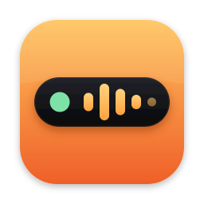

# Hermes Island

Talk out loud with your AI agent from anywhere on your Mac. Double-tap Left Control, say what you want, and an island at the top of the screen shows what you said, what the agent is doing, and what it found, while the agent answers in a voice made on your Mac. Double-tap again, or say goodbye, to hang up.

It is built for [Hermes Agent](https://github.com/NousResearch/hermes-agent) and works with any agent that speaks the [Agent Client Protocol](https://agentclientprotocol.com) (ACP), such as Claude Code, Codex or OpenCode, on this Mac or on another one over SSH.

<!-- Screen recording of a talk goes here: docs/talk.gif -->

Hermes Island began as the live talk feature of [Lip Service](https://github.com/hunterbohm/lip-service), a dictation app. It does no dictation and never listens on fn or Right Control, so it runs beside any dictation app.

## Requirements

- A Mac with Apple silicon and macOS 26 or later.
- About 600 MB of disk for the speech model and the on-Mac voice, downloaded on first use.
- An ACP agent. With Hermes: `hermes acp` on this Mac, or on another Mac you reach with `ssh HOST` and no password.

## Use it

- **Double-tap Left Control** to start a talk, and again to end it. A talk also ends when you say goodbye, or after a long quiet.
- **⌃⌥M** mutes and unmutes your microphone during a talk. The island's buttons do the same, and end the talk.
- Talk over the agent to stop it. When it asks to use a tool, a spoken "no" refuses; reading, searching and thinking go ahead without asking; running commands or changing files needs **Allow** clicked on the card.
- With Hermes, each talk picks up the conversation where the last one ended. **Start a New Conversation** in the menu starts fresh.
- **Call backs.** A job that runs a while can ring you when it is done: `HermesIsland call --about "the deploy" < result.txt` rings the island, and when you answer, the agent tells you the result. Run it on this Mac or over SSH. See `HermesIsland --help`.

The menu bar item shows who you talk with, the voice, sounds, Open at Login, and **Edit Settings…**, which opens the settings as JSON in TextEdit and applies them when you save.

## Install

There is no signed release yet, so build it (below), then:

	ditto "dist/Hermes Island.app" "/Applications/Hermes Island.app"
	open "/Applications/Hermes Island.app"

On first launch macOS asks for two permissions:

- **Accessibility**, to see the Left Control double tap and ⌃⌥M. Turn Hermes Island on in System Settings > Privacy & Security > Accessibility.
- **Microphone**, asked at the first talk.

Open at Login is on by default; the menu bar item turns it off.

## Set up Hermes

With Hermes on this Mac there is nothing to do: the app starts `hermes acp`. With Hermes on another Mac you reach by `ssh HOST` without a password:

	"/Applications/Hermes Island.app/Contents/MacOS/HermesIsland" agent --hermes --host HOST

The [Hermes plugin](hermes-plugin/README.md) adds call backs, a job that rings the island when it is done, and `hermes island status|setup|build`. Install it from the Hermes plugin catalog with `hermes plugins install hermes-island`, then `hermes island build --install` clones this repository at the commit the plugin came from, builds the app and installs it.

## Settings

The settings are one JSON value in the app's defaults (`dev.hermes-island.app`, key `settings`). On first launch the app copies a Lip Service user's agents, live talk voice, microphone and sounds, and the conversation each agent was in. Lip Service's own settings are only read. Without Lip Service it starts with Hermes on this Mac.

An agent entry looks like this. `remoteHost` runs the command over SSH on that host; leave it out to run it here.

	{"id": "hermes", "name": "Hermes", "presetID": "hermes", "command": ["hermes", "acp"], "remoteHost": "my-mac",
	 "spokenNames": ["Hermes"], "draftOptions": [], "taskOptions": [],
	 "talkOptions": [{"option": {"id": "model", "value": "anthropic:claude-opus-5-5"}}],
	 "destination": {"iMessage": {"handle": ""}}}

## Privacy

- Your speech becomes text on your Mac. Audio stays in memory and is never written to disk or sent anywhere. The agent gets your words as text.
- The agent's replies are spoken by a voice made on your Mac (Phonon or Kokoro), unless you set a voice server, which then gets the replies as text.
- The app goes online by itself only to download the speech model and the voice from huggingface.co on first use, pinned to commits and checked against SHA-256 hashes built into the app. It has no account, no usage count and no update check.
- To see Left Control and ⌃⌥M, the app watches the keyboard through Accessibility. It reacts to those two keys only and does not record, store or send any key.

## Build from source

You need the Command Line Tools with Swift 6.2 or later. Xcode is not needed.

	scripts/fetch-deps.sh     # vendors FluidAudio v0.18.3 and patches it
	scripts/test.sh           # runs the IslandCore tests
	scripts/build-app.sh      # builds and signs dist/Hermes Island.app

`build-app.sh` signs with a self-signed certificate it makes on the first run and keeps in `~/.config/hermes-island/signing`, so macOS keeps the Microphone and Accessibility grants across rebuilds. `scripts/make-icon.sh` renders the icon from `Resources/Icon/` (needs `brew install librsvg`).

`HermesIsland --test-talk --preset hermes --host HOST clip.wav` holds a whole talk with no microphone or speakers: each WAV clip is your next turn, and it prints the agent's reply and timings as JSON.

## Hermes plugin

The plugin is in [hermes-plugin/](hermes-plugin/README.md). What is left before it goes into the Hermes plugin catalog is in [docs/hermes-plugin.md](docs/hermes-plugin.md).

## Credits

- [FluidAudio](https://github.com/FluidInference/FluidAudio) v0.18.3, by FluidInference, Apache 2.0, runs the speech and voice models. `scripts/fetch-deps.sh` patches it; see the script.
- [Parakeet TDT 0.6B v2](https://huggingface.co/nvidia/parakeet-tdt-0.6b-v2), by NVIDIA, in FluidInference's [Core ML conversion](https://huggingface.co/FluidInference/parakeet-tdt-0.6b-v2-coreml), CC BY 4.0, turns speech into text.
- The voices are downloaded at run time under their own licenses; the app ships none of them.

## Contributing

See [CONTRIBUTING.md](CONTRIBUTING.md).

## License

MIT. See [LICENSE](LICENSE).
